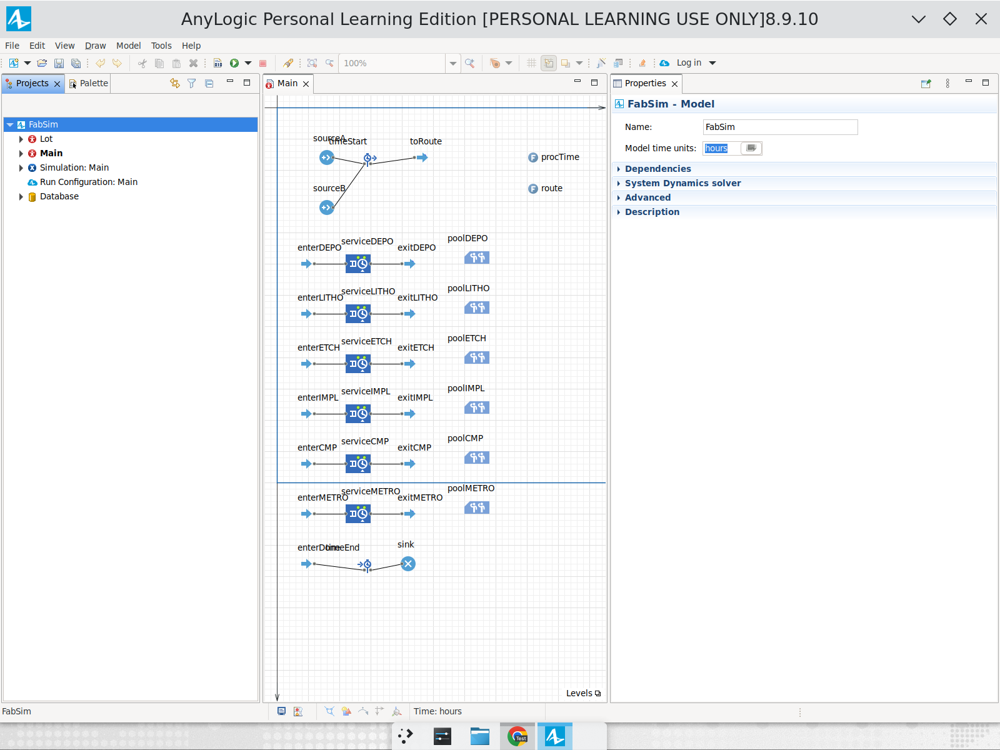
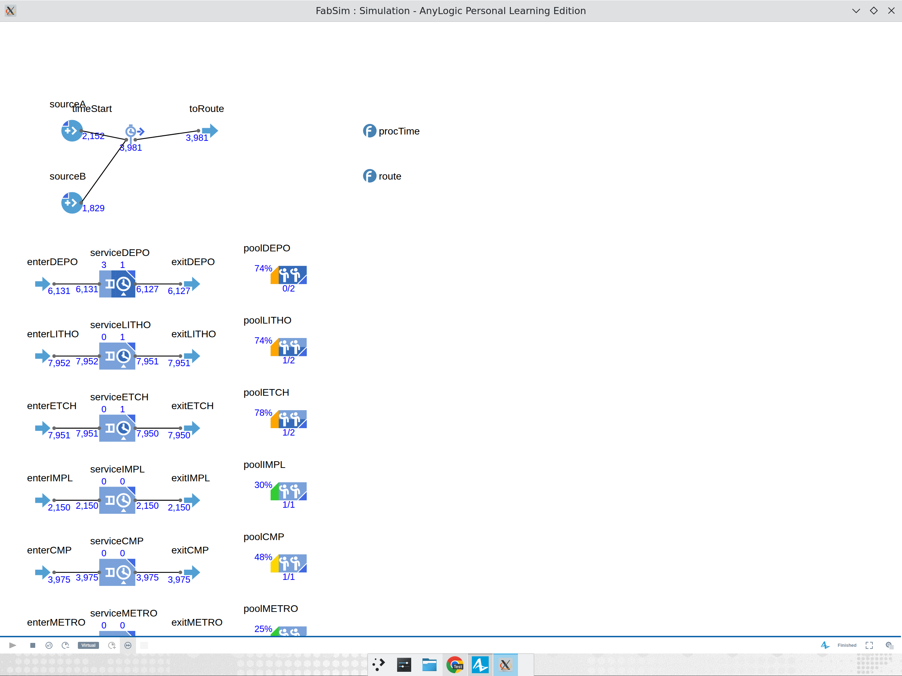

# Semiconductor Fab Discrete-Event Simulation & Scheduling

Discrete-event simulation of a mini semiconductor fab in **AnyLogic 8 (PLE)**, plus a **MILP job-shop scheduler** in Python (PuLP with Gurobi/HiGHS) benchmarked against dispatching rules. All data is synthetic.

## The system
- 6 tool groups: DEPO (2 tools), LITHO (2), ETCH (2), IMPL (1), CMP (1), METRO (1)
- 2 products with **re-entrant routes** (lots return to the same tool groups):
  - A: DEPO → LITHO → ETCH → IMPL → DEPO → LITHO → ETCH → CMP → METRO
  - B: DEPO → LITHO → ETCH → CMP → LITHO → ETCH → METRO
- Arrivals: 6 lots/day of A, 5 lots/day of B (Poisson)
- Processing times: triangular ±10% around the route time
- Random tool failures: exponential MTBF and MTTR per tool group

## Model design (AnyLogic)
`Source → TimeMeasureStart → Exit` calls `route(lot)`. That function looks up the lot's next step in the `routes` database table and sends the lot to the matching `Enter → Service → Exit` chain. Each Service seizes one tool from its ResourcePool. After the last step, lots go to `Enter → TimeMeasureEnd → Sink`.



## Validation
One simulated year (8,760 h). Utilization compared with the hand-calculated value,
utilization = (arrival rate × hours of work per lot) / (number of tools × availability):

| Tool group | Expected | Simulated (AnyLogic, 1 year) |
|---|---|---|
| DEPO  | 75.3% | 74% |
| LITHO | 75.7% | 74% |
| ETCH (bottleneck) | 79.3% | 78% |
| IMPL  | 31.0% | 30% |
| CMP   | 49.1% | 48% |
| METRO | 25.3% | 25% |

One simulated year released 3,981 lots (2,152 A + 1,829 B). Every tool group is within 1.5 percentage points of its hand calculation, and ETCH is the bottleneck in both.



## Scheduling MILP (Python)
`python/schedule_milp.py` builds a flexible job-shop MILP: start times, tool-assignment binaries, and disjunctive (big-M) sequencing constraints, with a makespan objective. It compares the result with FIFO, SPT, LWKR and MWKR dispatching rules. On 3 A lots + 3 B lots, Gurobi proved the optimal makespan is 16.7 h; FIFO, SPT and MWKR give 16.8 h and LWKR 18.7 h. An independent checker confirms that every schedule respects route order and that no tool is double-booked.

## How to run
1. `pip install pandas openpyxl pulp highspy` (add `gurobipy` to use Gurobi)
2. (Optional) `python python/generate_fab_data.py` regenerates `fab_data.xlsx`; move it into `data/`
3. `python python/schedule_milp.py --data data/fab_data.xlsx --lots-a 3 --lots-b 3 --solver highs`
4. Open `anylogic/FabSim.alp` in AnyLogic 8.9 (PLE is enough) and click Run

## Repository layout
```
anylogic/   FabSim.alp + database/
python/     generate_fab_data.py, schedule_milp.py
data/       fab_data.xlsx
results/    screenshots and charts
```

## Next steps
Dispatching rules inside AnyLogic, WIP and cycle-time charts, what-if experiments (e.g. a third ETCH tool), and replaying the MILP schedule in the simulation.
